# WeCare: Pharmacy POS & Dispensing Platform

> Every branch on one live system, with each tenant's data walled off in the database and the owner watching it all from a phone.

**Status:** Live · **Client:** Multi-branch pharmacy and clinic operator · **Role:** Solo architect & full-stack engineer

**Stack:** `React 19` `Supabase` `Row-Level Security` `Multi-Tenant` `PostgreSQL`

> [!NOTE]
> **Showcase repository.** The source code is private and belongs to the client. This repo documents the problem, the architecture, and the results. Screens show demo data. Full case study: https://lesjohnpauloliver.dev/work/wecare-pharmacy-pos-dispensing-platform

## Summary

A multi-tenant operations platform for a multi-branch pharmacy and clinic operator: point-of-sale dispensing, PhilHealth benefit dispensing and claims, inventory, and live executive dashboards across every branch.

## Scale

- Live in production since August 2026 for a multi-branch pharmacy network
- 85 database migrations, all applied through version control
- 66 SQL functions and RPCs hold the business rules
- 5 user roles, branch-scoped by row-level security
- 14 unit-test suites; 260+ commits since June 2026
- Stock-value ledger load-tested at 10× production volume: 143 ms worst case

## The problem

- The owner could not see stock value, near-expiry batches, or items about to run out per branch until it was too late.
- PhilHealth claims that are late or incomplete get denied, and the filing window closes after 60 days.
- Receipts had to meet BIR rules for the POS to be accredited.
- One platform had to serve many branches, and many pharmacy groups, without anyone seeing another's data.

## Problem → fix

### The owner could not see stock value, near-expiry batches, or items about to run out per branch until it was too late.

An executive dashboard and Command Center show today's sales, transactions, VAT, low stock, and near-expiry across every branch, with 30-day trends and product mix per branch.

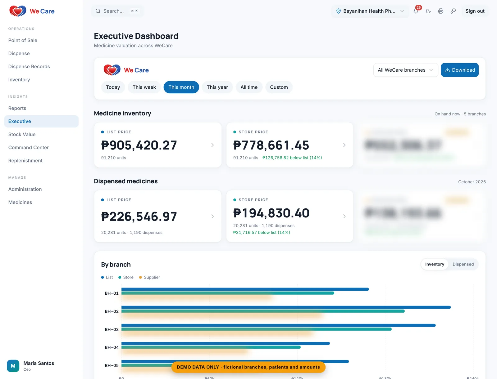
Executive dashboard: medicine inventory and dispensed value across every branch at list and store prices, with a per-branch breakdown.
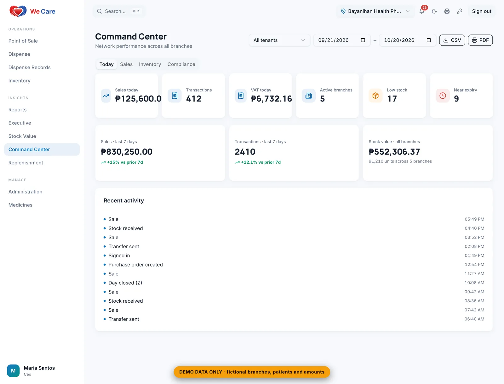
Command center: today's sales, transactions, VAT, active branches, and low-stock and near-expiry alerts, with live activity across the network.
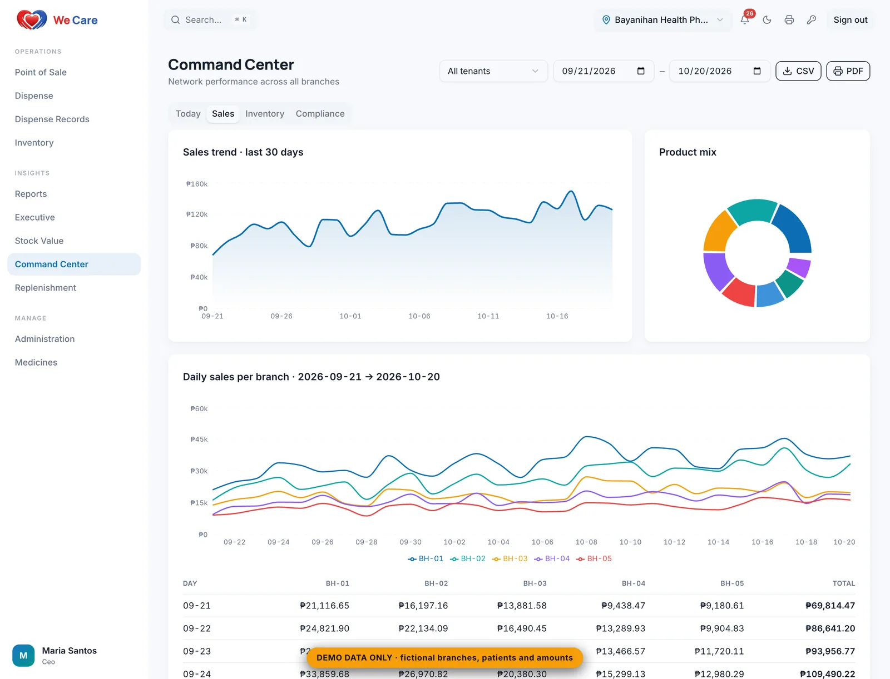
Sales view: 30-day trend, product mix, and daily sales per branch.
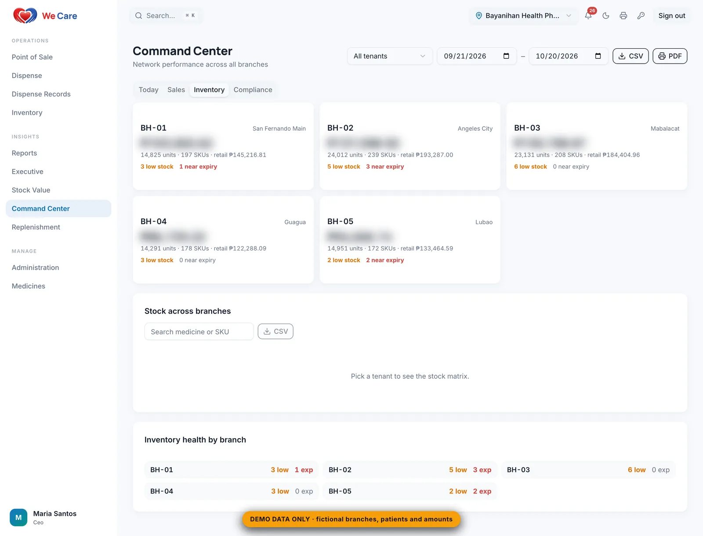
Inventory view: stock value and inventory health for each branch.
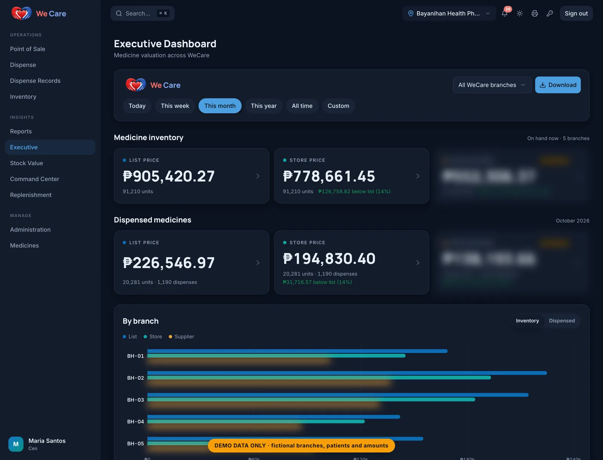
The executive dashboard in dark mode.

### PhilHealth claims that are late or incomplete get denied, and the filing window closes after 60 days.

The counter checks the 12-digit PhilHealth ID and the remaining annual benefit, captures signatures, and prints a claim slip per dispense. Claims are assembled from the dispense records against the 60-day deadline.

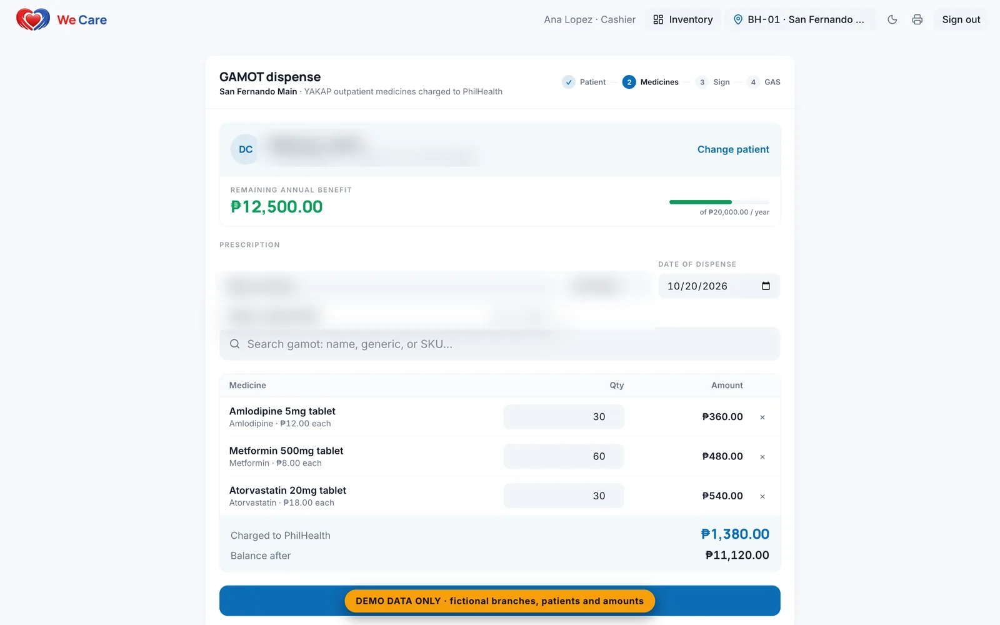
PhilHealth outpatient dispensing: checks the member's remaining annual benefit and charges eligible medicines to PhilHealth. Patient details blurred.
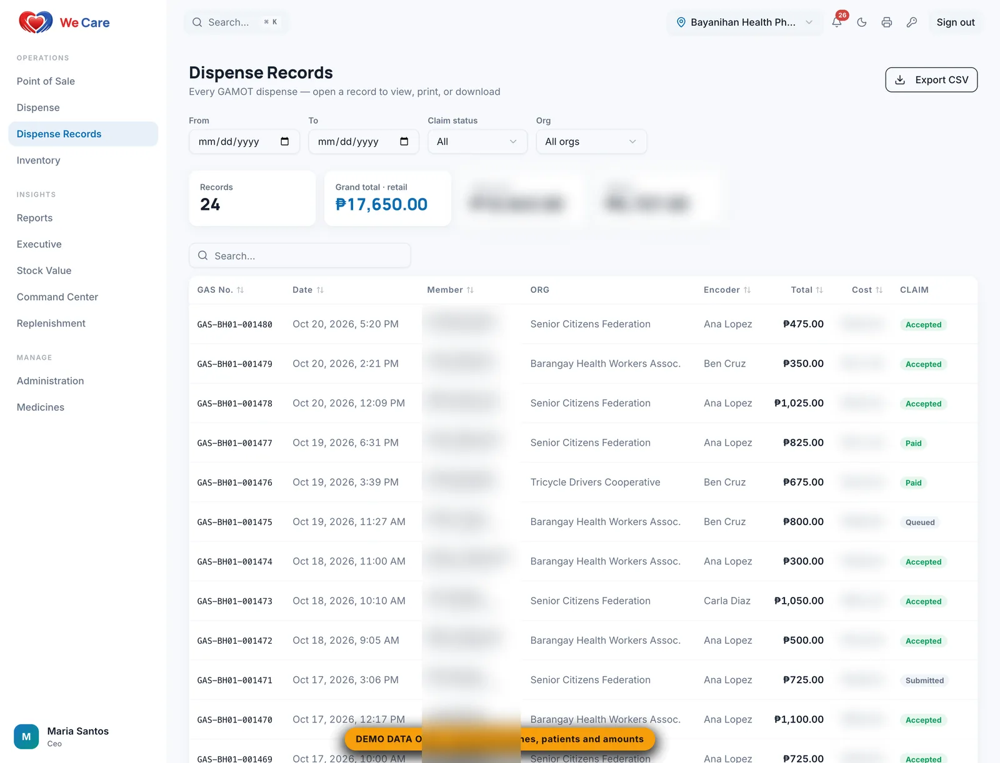
Dispense records: every PhilHealth dispense with its claim status, ready to export. Member details blurred.

### Receipts had to meet BIR rules for the POS to be accredited.

A touch-first POS with FEFO batches and Regular, Senior, and PWD pricing issues receipts, X readings, Z close, SC/PWD discount books, voids, and reprints following BIR RMO 24-2023.

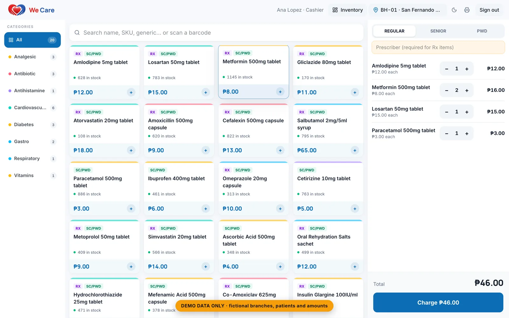
Point of sale: a barcode-ready medicine catalog with regular, senior, and PWD pricing; prescription items require a prescriber.
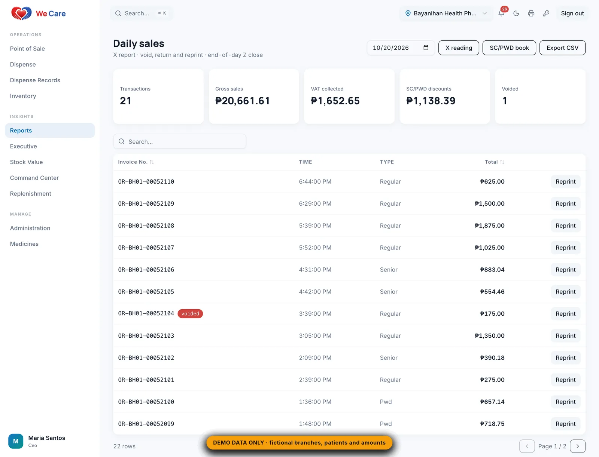
Daily sales: X and Z readings, voids, returns and reprints, the SC/PWD discount book, and VAT collected.

### Items ran out and batches expired at a branch before anyone noticed.

Inventory tracks stock, batches, and reorder points per branch. An expiry view lists batches within 90 days, soonest first, replenishment builds per-branch picking lists, and low-stock and near-expiry alerts arrive every morning at 8 AM.

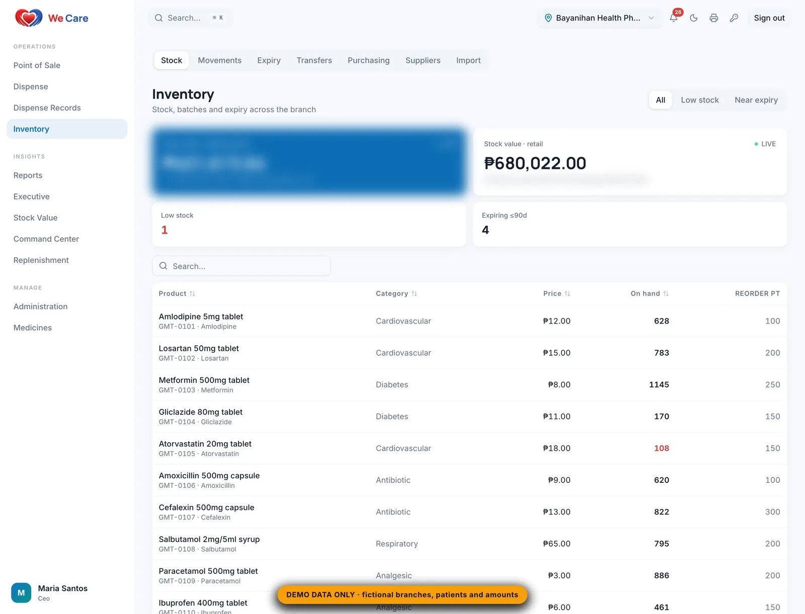
Inventory: stock, batches, and reorder points per branch, with movements, transfers, purchasing, and suppliers.
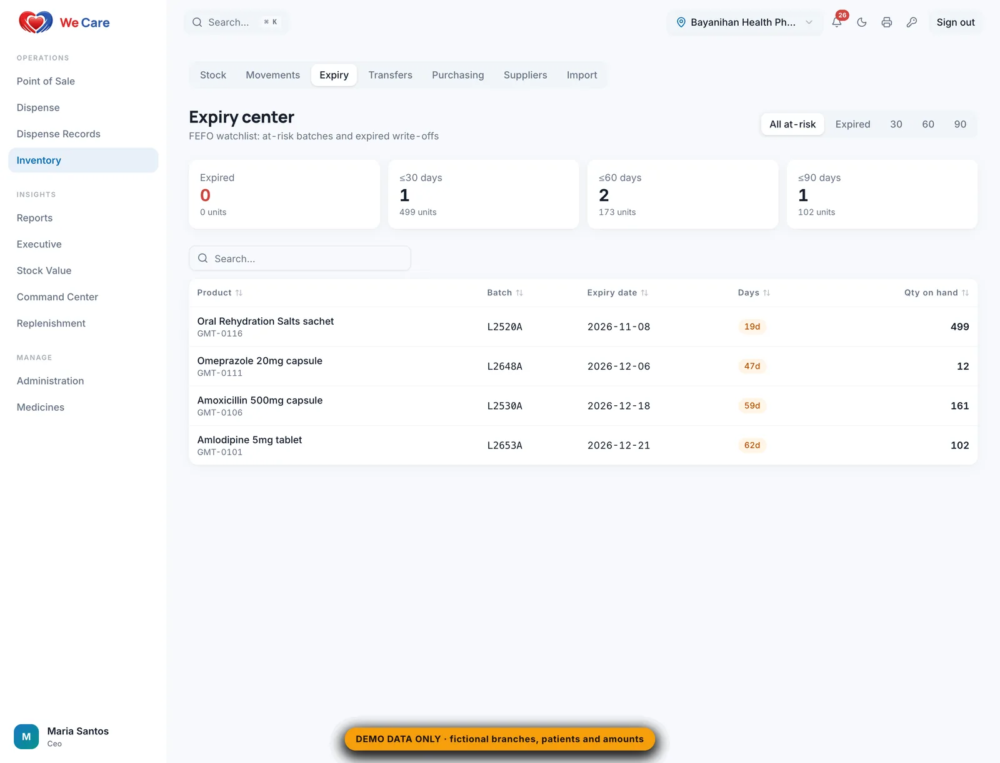
Expiry center: a FEFO watchlist of batches expiring within 30, 60, and 90 days.
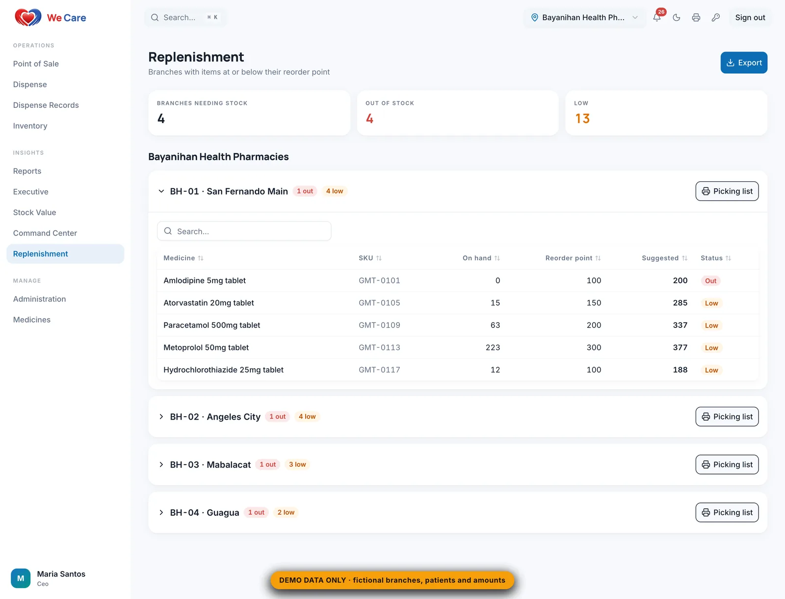
Replenishment: branches at or below their reorder point, with suggested quantities and printable picking lists.

### The owner could not see what each branch's stock was worth, or why that number changed.

A Stock Value ledger reconciles opening stock, receipts, sales, dispenses, adjustments, and closing, day by day, and values stock three ways: PhilHealth price, store price, and supplier cost.

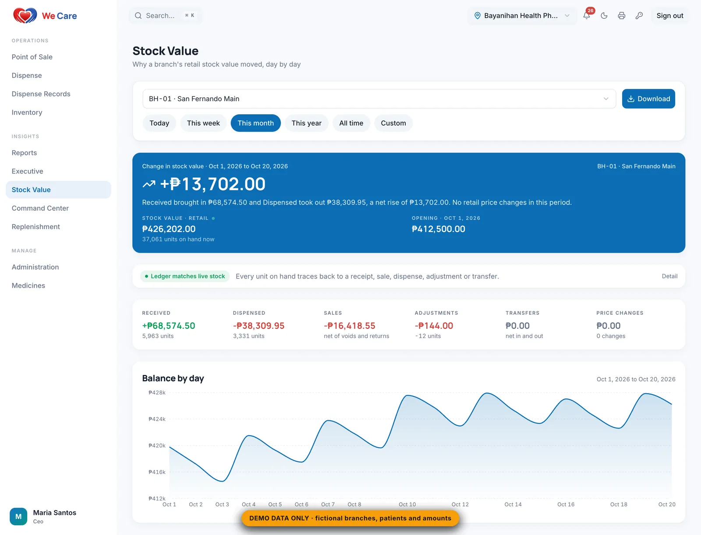
Stock value: why a branch's retail stock value moved, day by day, reconciled against a ledger that matches live stock.

### One platform had to serve many branches, and many pharmacy groups, without anyone seeing another's data.

Row-level security on every table scopes each user to their tenant and branch, so even a hand-crafted API call sees nothing it should not. A two-tenant test matrix checks that one tenant sees zero rows of another.

## Approach

- The database is the security boundary: row-level security on every table, with tenant and branch scope taken from the signed-in user, so a hand-crafted API call still sees nothing it should not.
- Money-moving operations (sales, dispenses, stock receipts, voids) are single Postgres functions that check role, module, and stock in one transaction.
- Business rules live once in SQL: FEFO batch selection, the annual benefit cap, receipt numbering, and stock valuation. Every screen, export, and alert reads the same numbers.
- Executive views call purpose-built server-side aggregates instead of downloading raw rows.

## What was built

- Touch-first dispensing POS with FEFO batches, Rx and SC/PWD pricing, and BIR receipts
- PhilHealth benefit dispensing with ID and remaining-benefit checks, signatures, and claim slips
- Inventory, expiry, replenishment, branch transfers, and purchase orders
- Executive Command Center and Stock Value ledger across all branches
- Vendor console that provisions tenants, branches, users, modules, and monthly billing

## Capabilities

**Point of sale**
- Touch-first cart with live stock per item
- Regular, Senior, and PWD pricing with Rx flags
- Receipts, X readings, Z close, SC/PWD discount books, voids, and reprints following BIR RMO 24-2023
- Thermal receipt printing

**PhilHealth benefit dispensing**
- 12-digit PhilHealth ID check and remaining annual benefit at the counter
- Prescriber auto-suggest, signatures, and a claim slip per dispense
- Dispense records with status, encoder, cost, and margin
- Claims assembled against the 60-day filing deadline

**Inventory**
- Live stock value at cost and retail, with batches and reorder points
- Expiry view of batches within 90 days, soonest first (FEFO)
- Replenishment with per-branch picking lists and Excel export
- Branch transfers and purchase orders
- Low-stock and near-expiry push alerts every morning at 8 AM

**Executive dashboards**
- Command Center: today's sales, transactions, VAT, low stock, and near-expiry across every branch
- Stock valued three ways: PhilHealth price, store price, and supplier cost
- Stock Value ledger reconciling opening, receipts, sales, dispenses, adjustments, and closing, day by day
- 30-day sales trends and product mix per branch
- Branded PDF, Excel, and CSV exports for the board

**Multi-tenant SaaS**
- Vendor console to provision tenants, branches, and users
- Module flags per tenant and per branch
- Monthly billing statements by email

**Security and roles**
- 5 roles: Pharmacist, Manager, Owner, CEO, Vendor
- Row-level security on every table
- Installable PWA with an offline shell

## Architecture

- React 19 and TypeScript PWA hosted on Cloudflare Pages.
- Supabase Postgres with row-level security, RPC functions, Auth, Realtime for live stock, and Storage for signatures and claim proof.
- Edge Functions handle user provisioning, billing statements, and push digests; pg_cron schedules the 8 AM digest and monthly billing.
- Web Push for alerts, transactional email for statements, and a local print bridge for thermal receipts.

## Engineering

- Tenant isolation is tested, not assumed: a two-tenant matrix checks that one tenant sees zero rows of another on every table and role.
- Valuation, reconciliation, replenishment, billing, and Excel export are pure TypeScript modules with unit tests, shared by the UI and the exports.
- Stock-value ledger load-tested at 10× production volume, 143 ms worst case.
- CI runs lint, type-check, and tests; a pre-deploy guard blocks any build missing its production environment.

## Where AI does the work

Scheduled automation does the watching: low-stock and near-expiry alerts arrive every morning, and claims are assembled from the dispense record instead of paper.

## Outcome

- Live in production since August 2026.
- The operator runs every branch from one platform, with data isolated per tenant and a live CEO view.

---

Built by **[Les John Paul Oliver](https://lesjohnpauloliver.dev)**, AI Engineer in the Philippines: agentic AI, RAG, LLM evals, MCP, and business automation. [Case studies](https://lesjohnpauloliver.dev/#projects) · [Hire me](https://lesjohnpauloliver.dev/ai-engineer-philippines)
